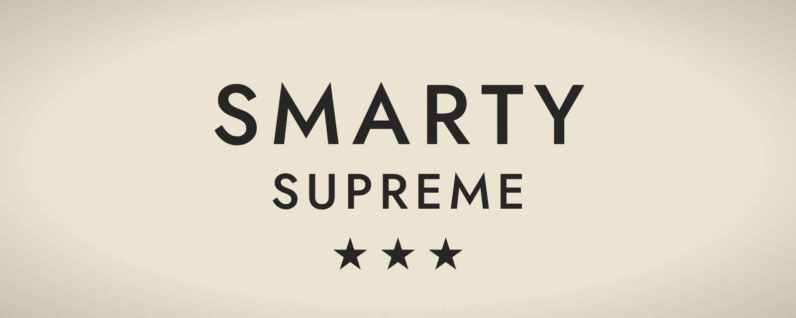
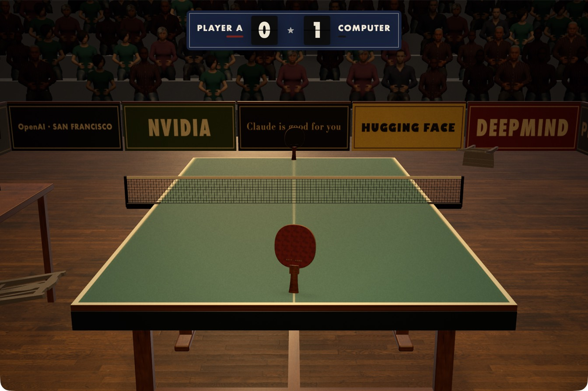

<picture>
  <source media="(prefers-color-scheme: dark)" srcset="docs/brand/header-dark.png">
  
</picture>

<b>Table tennis, 1952. Your iPhone is the bat.</b>

A packed hall, one table under the lights, an umpire calling every point, and a computer opponent who learned to talk on tech Twitter. Your phone is the bat: angle the face to aim, swing harder for pace, brush up for topspin, tap the screen to toss a serve. Your player walks to the ball.

- **Play the computer** on Easy, Medium or Hard, and hear about it when you miss.
- **Play a friend** side by side in split screen, or bring a second Mac so each of you gets a full screen.
- **No phone?** Play on the keyboard: press W as the ball comes and your player swings on time; hold A/D to aim. Player B uses ↑ and ← →.

Needs macOS 26 and iOS 18. [Build it from source](docs/DEVELOPMENT.md).
