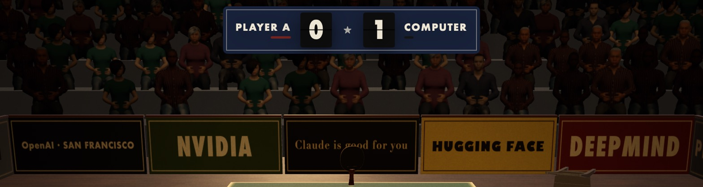
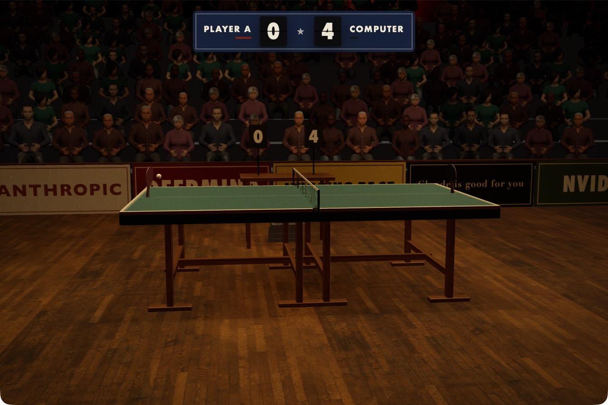

<picture>
  <source media="(prefers-color-scheme: dark)" srcset="docs/brand/header-dark.png">
  
</picture>

  <b>Table tennis, 1952. Your iPhone is the bat.</b>

  
  
  

The hall is full. Two thousand people in their Sunday best lean forward in the dark. One green table sits under the lights, the umpire waits at the desk with the flip cards, and across the net your opponent is a computer that won't stop talking.

Pick up your phone. Hold it like a hardbat. Swing.

---

### Your phone is the bat

No controller, no buttons. Tilt the phone to slide across the table and swing it at the screen to hit. Swing harder and the ball comes off the bat faster. The phone turns into a pimpled-rubber hardbat in your hand and kicks back on every contact.

### An opponent with something to say

The computer comes in three moods. **Easy** keeps it friendly. **Medium** starts finding the side of the table you're not covering. **Hard** does it on every single ball.

It also talks. Fresh off tech Twitter, it has an opinion about every point:

> *"Skill issue."*
> *"An edge? That's a bug."*
> *"My model hallucinated."*
> *"Let him cook."*

Beat it and it might even admit you're actually him.

### Under the lights

Every point is called the way it is at a real tournament: *"Seven, five." "Deuce." "Game, Player A."* The cards on the umpire's desk flip with the score, and the stands murmur, sway and break into applause when a rally ends. The boards around the court were sold to the hottest names of the day, and the whole thing plays out in warm overhead light and fine 35mm grain.

### Bring a friend

Two phones, one Mac, first to eleven. Or bring a second Mac, set them back to back, and each player gets their own end of the table. No phones? Two people can share a keyboard.

---

## How to play

Open **Smarty Supreme** on the Mac and a game against the computer starts right away. Open **Smarty Paddle** on your iPhone, point it at the screen and tap **Calibrate**. That's it.

First to 11, win by two. Change opponent or difficulty with **File › New Game** (⌘N).

| | Move | Hit |
| --- | --- | --- |
| iPhone | Tilt left and right | Swing toward the screen |
| Keyboard, Player A | A and D | W |
| Keyboard, Player B | ← and → | ↑ |

**Esc** pauses · **⌘1 ⌘2 ⌘3** change the camera · **Game › Commentary** quiets the hall

For two players, pick **Another Player** in New Game, calibrate both phones and tap **Ready**. To give Player B their own view, open Smarty Supreme on a second Mac on the same Wi‑Fi and choose **File › Use as Player B's Screen**.

## Getting it

You'll need a Mac on macOS 26 and an iPhone on iOS 18, on the same Wi‑Fi. Smarty Supreme isn't on the App Store; [build it from source](docs/DEVELOPMENT.md).

---

Arena light, wood and furniture from <a href="https://polyhaven.com">Poly Haven</a>, spectators from <a href="http://www.makehumancommunity.org">MakeHuman</a>, sounds from <a href="https://freesound.org">Freesound</a> (all CC0). Voices recorded with <a href="https://huggingface.co/hexgrad/Kokoro-82M">Kokoro</a>. Title set in Jost. A fan-made personal project inspired by 1950s table tennis; not affiliated with any film, studio or sponsor shown.
