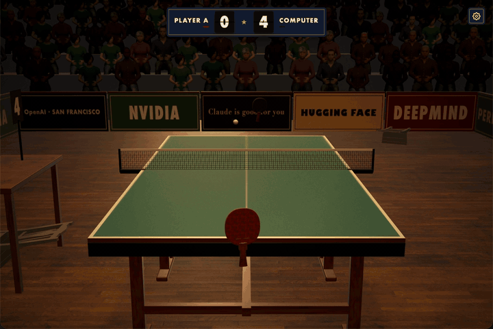

  <picture>
    <source media="(prefers-color-scheme: dark)" srcset="docs/brand/header-dark.png">
    
  </picture>

<b>Table tennis on the Mac. The paddle is your iPhone.</b>

  

Smarty Supreme is a table tennis game for the Mac. You play it by swinging your iPhone as the paddle. The match is in a packed hall, with one table under the lights and an umpire calling every point. Your player walks to the ball automatically, so the timing and the stroke are yours. The computer opponent talks like tech Twitter.

- **Swing.** Tilt the paddle face to aim, and swing harder for more pace. Brush up for topspin, chop down for backspin. Hold the screen toward you for a forehand and turn it away for a backhand.
- **Serve.** Tap the phone’s screen to toss the ball, then swing as it falls.
- **Time it.** A ring shrinks onto the ball. An early swing pulls the shot cross-court and a late one sends it down the line. The phone buzzes crisply for a clean hit and dully for an edge.
- **Play the computer** on Easy, Medium or Hard.
- **Play a friend** side by side in split screen on one Mac, or use a second Mac as Player B’s screen.
- **No phone?** Any side without a phone plays on the keyboard. Player A presses W to swing or serve and holds A/D to aim. Player B uses ↑ and ←/→.

Needs macOS 26 and iOS 18. To build it from source, see [docs/DEVELOPMENT.md](docs/DEVELOPMENT.md).
